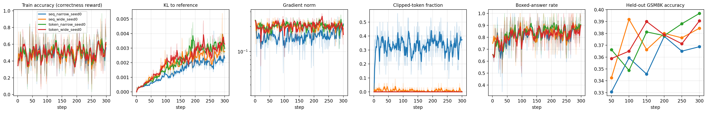

# GRPO Clipping Study（NLP 课程项目，Team 4）

在小模型上检验 ARLArena 的 Finding 1：**tolerant token-level clipping 和 sequence-level clipping，哪种让 GRPO 训练更稳定。**

> 本文件夹是我们自己的实现，基于 Hugging Face TRL，单张 GPU 即可运行，**不依赖**本仓库其他部分（ARLArena 原代码基于 verl，面向 8 卡、4B 模型）。ARLArena 的 loss 实现在 `verl/trainer/ppo/core_algos.py`（GSPO 约第 1015 行，SAPO 约第 1448 行），可作为参考。

## 研究问题与假设

- **对比**（与 proposal 一致）：(a) tolerant token-level clipping（放宽 clip 上界） vs. (b) sequence-level clipping（GSPO）
- **Hypothesis**：tolerant clipping will produce faster early improvement followed by collapse, while sequence-level clipping will be more stable.
- **控制变量**：两组之间只有 clipping 不同；模型、数据、reward、batch 大小、学习率、KL 系数、随机种子全部相同。

## 文件结构

```
course_project_grpo_clipping/
├── grpo_clipping_experiment.py   # 训练脚本（TRL GRPOTrainer + LoRA）
├── plot_pilot.py                 # 从日志画训练曲线
├── pilot.sbatch                  # NYU Torch 的 Slurm 提交脚本
└── results/
    ├── v2/   # 正式 pilot：4 组 × 300 步（每组的 run_config.json、log_history.json）+ v2_dynamics.png
    └── v1/   # 第一版 pilot：reward 设计有问题（见下文），仅作反例
```

## 实验设置

| 项目 | 设置 |
|---|---|
| 模型 | `Qwen/Qwen2.5-0.5B-Instruct` + LoRA（rank 16，alpha 32，dropout 0.05，q/k/v/o） |
| 数据 | GSM8K（`openai/gsm8k`）：训练集 7473 题（按 seed 打乱），测试用 test 前 200 题 |
| Prompt | "Please reason step by step, and put your final answer within \boxed{}." |
| Reward | 最后一个 `\boxed{}` 内数字与标准答案相等得 1；有可解析的 `\boxed{数字}` 额外得 0.1 |
| GRPO | 每步 4 题 × 每题 8 个回答（温度 1.0，最长 400 token）；advantage 按组归一化 |
| Off-policy | `num_iterations = 2`：每批回答用于 2 次更新（TRL 默认 1 次时 ratio 恒为 1，clipping 不起作用） |
| 优化 | AdamW，lr 1e-5（线性衰减），KL 系数 β = 0.04，梯度裁剪 1.0，300 步，bf16 |
| 评估 | 每 50 步在 200 道测试题上评估；每题采样 8 个回答，报告平均正确率（非 greedy） |
| 环境 | NYU Torch，单张 L40S；torch 2.14.1，TRL 0.23.1，transformers 4.57.6，peft 0.21.2 |

### Clipping 设置

| 组名 | 含义 | ratio 粒度 | ε_low / ε_high |
|---|---|---|---|
| **token_wide** | **(a) tolerant token-level** | token | 0.2 / 0.6 |
| **seq_narrow** | **(b) sequence-level (GSPO)** | sequence | 3e-4 / 4e-4 |
| token_narrow | 附加：标准 GRPO | token | 0.2 / 0.2 |
| seq_wide | 附加：宽松的 sequence-level | sequence | 3e-3 / 1e-2 |

按 proposal，主对比为 **token_wide vs. seq_narrow**，另外两组为附加参照。

## 如何运行（NYU Torch）

```bash
# 1. 建环境（需要 uv 自带的 Python，系统 Python 缺 Python.h，Triton 会编译失败）
uv python install 3.12
uv venv --python-preference only-managed -p 3.12 venv && source venv/bin/activate
uv pip install "torch==2.14.1" --index-url https://download.pytorch.org/whl/cu130
uv pip install "trl==0.23.1" "transformers==4.57.6" "peft==0.21.2" "datasets>=3.0" accelerate matplotlib

# 2. 在登录节点预先下载模型和数据
export HF_HOME=$SCRATCH/.huggingface
python -c "from huggingface_hub import snapshot_download; from datasets import load_dataset; snapshot_download('Qwen/Qwen2.5-0.5B-Instruct'); load_dataset('openai/gsm8k','main')"

# 3. 提交（先把 pilot.sbatch 里的 --account 改成自己的）
mkdir -p logs
sbatch pilot.sbatch token_wide --output_root runs_v2
sbatch pilot.sbatch seq_narrow --output_root runs_v2
#    冒烟测试：sbatch --time=00:20:00 pilot.sbatch token_wide --max_steps 5 --eval_steps 5 --n_eval 16 --output_root smoke
#    查看所有组：python grpo_clipping_experiment.py --list

# 4. 画图
python plot_pilot.py runs_v2/*
```

## 实验进度

| 轮次 | 内容 | 结果 |
|---|---|---|
| 冒烟测试 1 | 5 步 | 系统 Python 缺 `Python.h`，改用 uv 自带的 Python |
| 冒烟测试 2 | 5 步 | 跑通，约 16 秒/步；clipping 已触发 |
| v1 | 4 组 × 150 步，`<think>/<answer>` 格式 + 部分格式分 | **Reward hacking**：模型只输出 `<answer>数字</answer>`，回答长度约 55 → 10 token，准确率约 10% → 1% |
| **v2** | 4 组 × 300 步，改用 `\boxed{}` 格式 | 训练正常，结果见下 |

### v2 结果（单个 seed）

| 组名 | 训练准确率（前 30 步 → 最后 30 步） | 测试准确率（第 50 步 → 第 300 步） | 被 clip 的比例 | 最终 KL |
|---|---|---|---|---|
| **token_wide** | 51.7% → 55.2% | 35.9% → 39.1% | 0.02% | 0.0032 |
| **seq_narrow** | 48.1% → 55.8% | 33.1% → 36.9% | 33.3% | 0.0022 |
| token_narrow | 50.6% → 58.8% | 36.6% → 39.7% | 0.06% | 0.0032 |
| seq_wide | 48.8% → 56.7% | 34.2% → 38.4% | 0.94% | 0.0029 |



**目前的结论**
- Pipeline 可行：单张 L40S 每组约 1.1–1.4 小时。
- **两组都没有崩溃**，测试准确率的差距（约 3 个点）在噪声范围内（200 题的标准误约 ±3.4 个点）。Hypothesis 目前既未被支持，也未被推翻。
- tolerant 组的 clipping 几乎不触发（0.02%）：每批只更新 2 次、lr 1e-5，模型每步变化很小（KL 约 0.003），宽松的上界根本用不到。
- sequence-level 组约 33% 被 clip，KL 最低，更新最保守。
- 训练准确率曲线四组同起同落，原因是四组用同一个 seed，每一步的题目相同。

**已知局限**
- 每组只跑了 1 个 seed（seed 0）；proposal 计划跑多个 seed。
- 约 15% 的回答达到 400 token 上限被截断，两组比例相同。
- 300 步只用了约 8% 的训练集。
- 这里的 tolerant 指放宽 ε 上界（与 proposal 一致）；ARLArena 原文的 tolerant 指 CISPO/SAPO（保留越界 token 的梯度）。

## 下一步

1. **压力测试**：提高 off-policy 程度（`num_iterations` 4 / 8，或 lr 5e-5），看 tolerant 组是否开始崩溃。
2. 在 clipping 真正起作用的设置下，每组跑 3 个 seed，报告均值 ± 标准差。
3. 记录"负 advantage + 低 ratio"的 token 比例，检验论文提出的崩溃机制。
4. 参考本仓库的官方实现，加入 CISPO/SAPO 式的 tolerant 变体作对照。

## 说明

- `results/v1` 是旧版 reward 跑出来的；当前的 `grpo_clipping_experiment.py` 是 v2 版本。用 `plot_pilot.py` 画 v1 时，"Boxed-answer rate" 那张图的标签不适用。
- 每组的完整超参数记录在 `results/*/<组名>/run_config.json`，逐步指标记录在 `log_history.json`。
